<p align="center">
  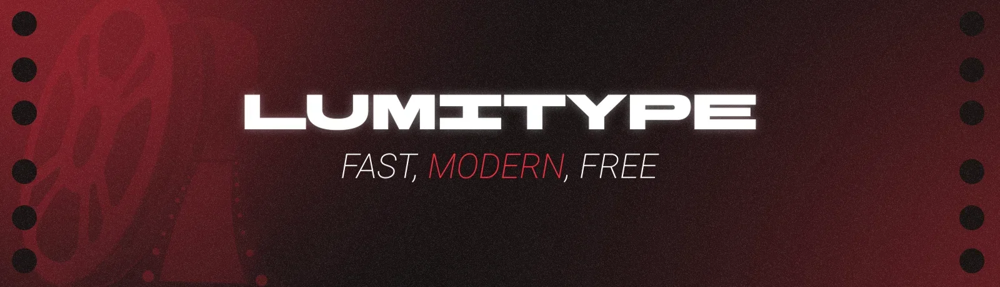
</p>

<p align="center"><a href="README.md">English</a> · <b>Français</b></p>

<p align="center">
  
  
  
  
  
  
</p>

Le nom Lumitype vient d'une machine à composer le texte. J'ai utilisé Claude AI pour développer ce logiciel, dont les principaux points forts sont les performances, la gratuité et l'interface moderne.

## Télécharger Lumitype 1.2.88

**Choisissez votre système.** Gratuit, sans compte.

| Système | Paquet | Installation |
|---|---|---|
| **Windows 10 / 11** | [Lumitype-Windows-Setup.exe](https://github.com/splaching-boop/Lumitype/releases/latest/download/Lumitype-Windows-Setup.exe) | Double-clic sur l'installateur |
| **Windows** : paquet MSI | [Lumitype-Windows.msi](https://github.com/splaching-boop/Lumitype/releases/latest/download/Lumitype-Windows.msi) | Pour un déploiement en entreprise (Intune, GPO) ou une installation silencieuse : `msiexec /i Lumitype-Windows.msi /qn` |
| **Windows** : portable | [Lumitype-Windows-portable.exe](https://github.com/splaching-boop/Lumitype/releases/latest/download/Lumitype-Windows-portable.exe) | Sans installation : se lance depuis n'importe quel dossier ou une clé USB |
| **Fedora** · RHEL · openSUSE | [Lumitype-Fedora-x86_64.rpm](https://github.com/splaching-boop/Lumitype/releases/latest/download/Lumitype-Fedora-x86_64.rpm) | `sudo dnf install ./Lumitype-Fedora-x86_64.rpm` |
| **Debian** · Ubuntu · Mint | [Lumitype-Debian-Ubuntu-amd64.deb](https://github.com/splaching-boop/Lumitype/releases/latest/download/Lumitype-Debian-Ubuntu-amd64.deb) | `sudo apt install ./Lumitype-Debian-Ubuntu-amd64.deb` |
| **Tout Linux** : AppImage | [Lumitype-Linux-x86_64.AppImage](https://github.com/splaching-boop/Lumitype/releases/latest/download/Lumitype-Linux-x86_64.AppImage) | `chmod +x Lumitype-Linux-x86_64.AppImage && ./Lumitype-Linux-x86_64.AppImage` |
| **Tout Linux** : Flatpak | [Lumitype-Linux.flatpak](https://github.com/splaching-boop/Lumitype/releases/latest/download/Lumitype-Linux.flatpak) | `flatpak install --user ./Lumitype-Linux.flatpak` |
| **Tout Linux** : archive portable | [Lumitype-Linux-portable.tar.gz](https://github.com/splaching-boop/Lumitype/releases/latest/download/Lumitype-Linux-portable.tar.gz) | `tar -xzf Lumitype-Linux-portable.tar.gz` |

Les paquets Linux demandent la glibc 2.35 ou plus récente (Ubuntu 22.04, Mint 21, Debian 12, Fedora 36 et suivants). Sous Windows, le logiciel utilise WebView2 (inclus).

[Toutes les versions](https://github.com/splaching-boop/Lumitype/releases) · [Vérifier les empreintes (SHA256SUMS.txt)](https://github.com/splaching-boop/Lumitype/releases/latest/download/SHA256SUMS.txt)

<p align="center">
  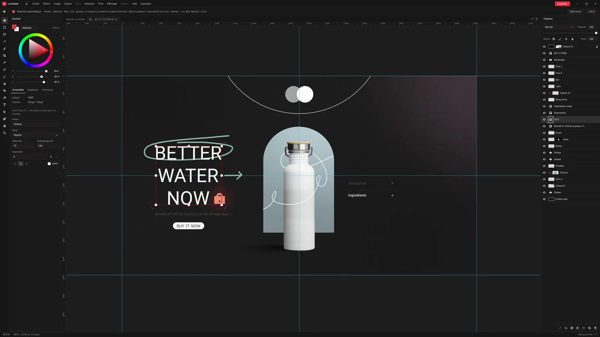
  <br>
  <sub><i>Interface de travail – Lumitype</i></sub>
</p>

## Nouveautés

**Paquets Linux pour toutes les distributions.** Les paquets sont compilés contre la glibc 2.35 : ils démarrent sur Linux Mint 21+, Ubuntu 22.04+, Debian 12+, Fedora 36+ et plus récents. Le Flatpak utilise GNOME 51. Corrige « GLIBC_2.43 introuvable » sur Mint 22.

Aussi : notice intégrée en 4 langues (F1), Préférences repensées, 13 nouveaux thèmes, vérification avant impression, PDF/X-4, temps de travail par projet, imports et nouveaux calques qui restent dans le plan de travail actif.

## Fonctionnalités

<table>
<tr>
<td width="33%" valign="top">
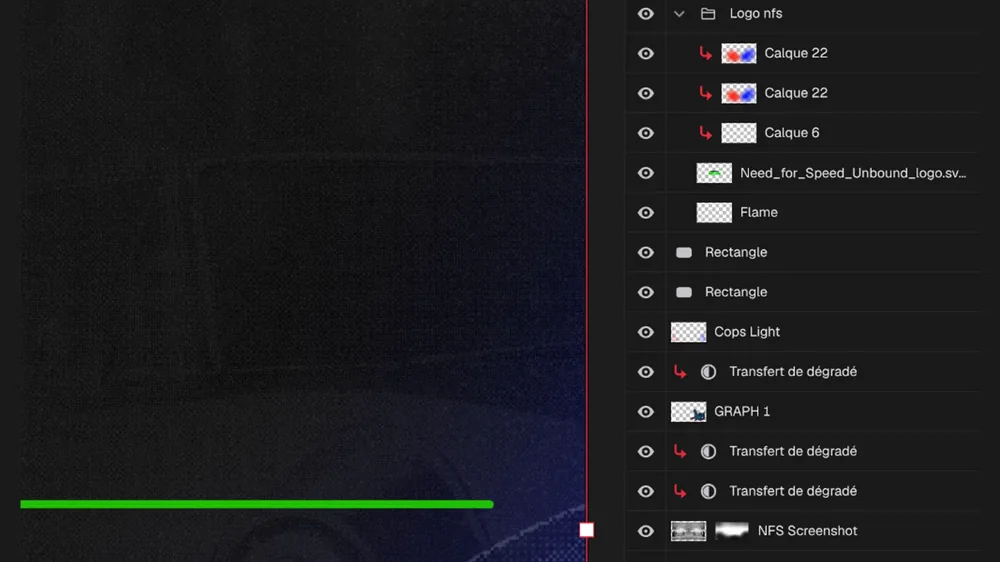
<h3>Organisation des calques</h3>
<p>Masques de fusion, masques d'écrêtage, groupes : j'ai essayé de reproduire fidèlement la méthode de travail de Photoshop.</p>
</td>
<td width="33%" valign="top">
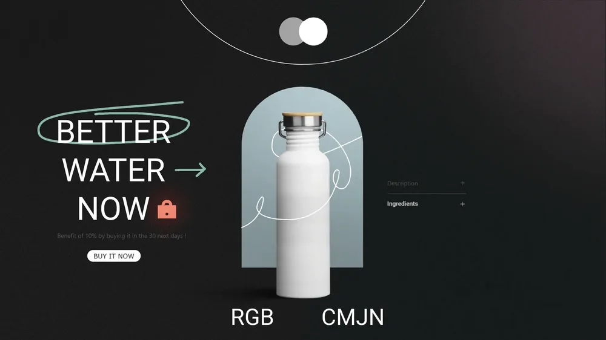
<h3>Pensé pour l'impression</h3>
<p>Épreuve CMJN avec profils ICC (FOGRA, GRACoL, SWOP), alerte d'encrage, fonds perdus et zone de sécurité, séparations, vérification avant impression et export PDF/X-4.</p>
</td>
<td width="33%" valign="top">
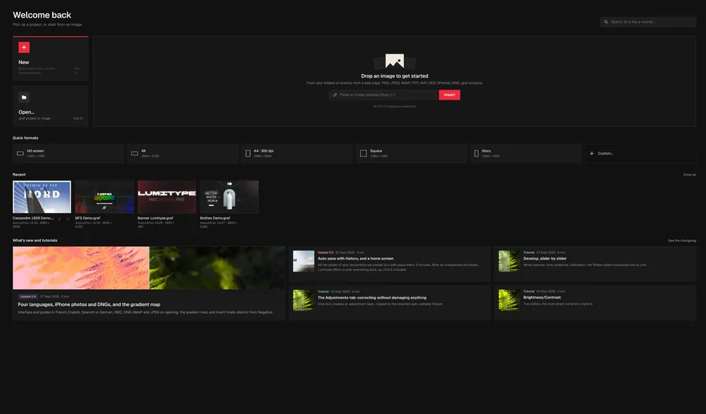
<h3>Accueil simple</h3>
<p>Retrouvez vos projets récents, ou glissez n'importe quelle image depuis votre navigateur pour commencer un projet !</p>
</td>
</tr>
</table>

### Repères aimantés

Aimantez vos images, la plume ou le texte aux repères : bien plus pratique !


### Une sélection de guides complète

<p align="center">
  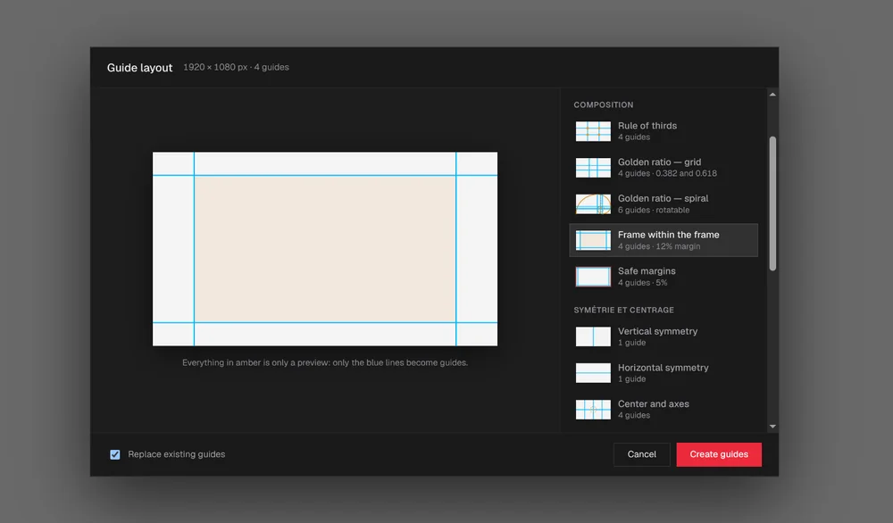
</p>

Aidez-vous des guides prédéfinis pour réaliser votre affiche, votre bannière ou tout autre contenu graphique !

## Pensé pour les graphistes

<table>
<tr>
<td width="50%" valign="top">
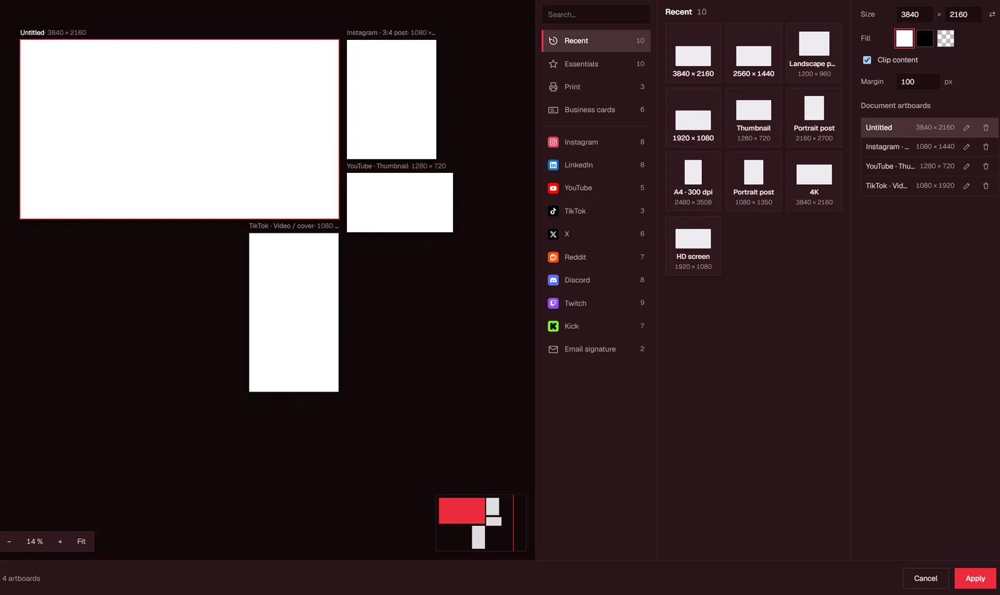
<h3>Plusieurs plans de travail dans un document</h3>
<p>Formats réseaux sociaux, formats d'impression et cartes de visite côte à côte, chacun exporté séparément. Choisissez un format du catalogue intégré (Instagram, LinkedIn, YouTube, TikTok, A4, cartes de visite) ou saisissez une taille.</p>
</td>
<td width="50%" valign="top">
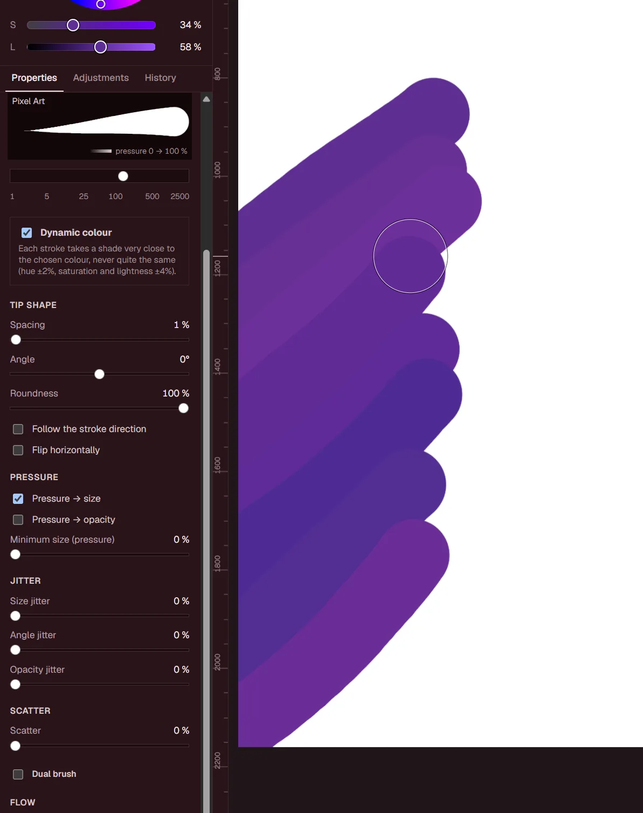
<h3>Meilleure prise en charge des pinceaux</h3>
<p>Importez des pinceaux Photoshop (.abr), GIMP (.gbr) ou n'importe quelle image comme pointe. Espacement, angle, rondeur, pression, variations, dispersion, pinceau double, texture et flux, avec aperçu de la pointe. Les traits sont peints par la carte graphique, en temps réel.</p>
</td>
</tr>
<tr>
<td width="50%" valign="top">
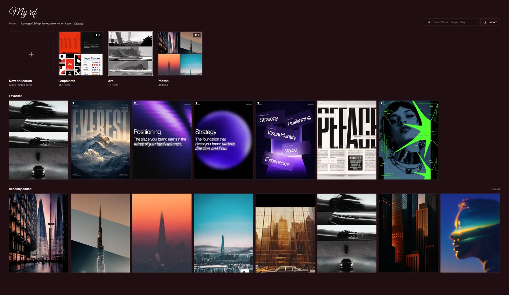
<h3>My ref : votre bibliothèque de références</h3>
<p>Rassemblez vos inspirations en collections, favoris et tags, directement depuis un dossier de votre disque. Recherche par nom ou par tag, glisser-déposer depuis le navigateur.</p>
</td>
<td width="50%" valign="top">
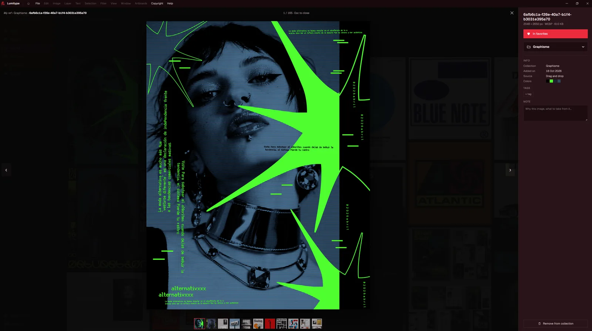
<h3>Une note sur chaque référence</h3>
<p>Chaque image garde sa collection, ses couleurs, ses tags et une note sur ce qu'il faut en retenir. Un clic l'envoie dans le projet en cours.</p>
</td>
</tr>
<tr>
<td width="50%" valign="top">
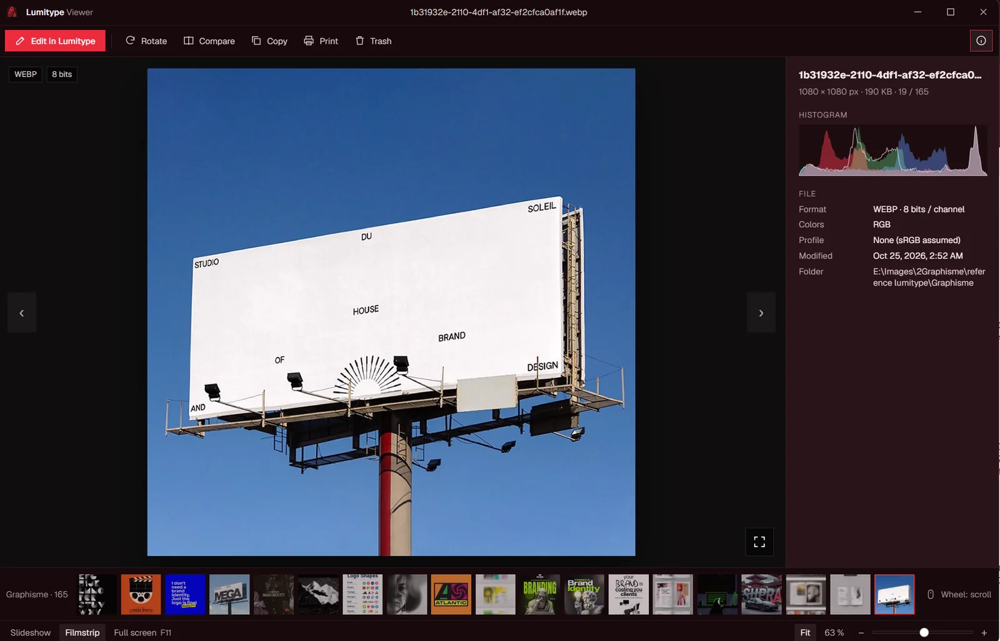
<h3>Visionneuse Lumitype</h3>
<p>Une visionneuse d'images séparée et légère, pensée d'abord pour les utilisateurs Linux qui veulent parcourir leurs fichiers RAW (ARW, CR3, NEF, DNG et 25 autres formats) à côté des JPEG, PNG, WebP, AVIF et HEIC. Histogramme, EXIF, profil ICC, diaporama, comparaison côte à côte, rotation sans perte, puis « Modifier dans Lumitype ».</p>
</td>
<td width="50%" valign="top">
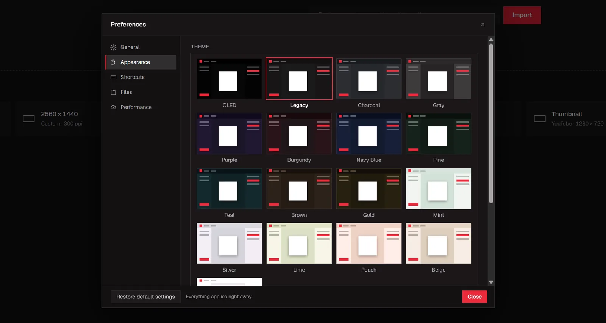
<h3>17 thèmes</h3>
<p>Du noir OLED au Beige clair, chacun avec sa couleur d'accent. Tout ce qui est réglé dans les Préférences s'applique immédiatement.</p>
</td>
</tr>
</table>

### Galerie de filtres

<table>
<tr>
<td width="33%" valign="top">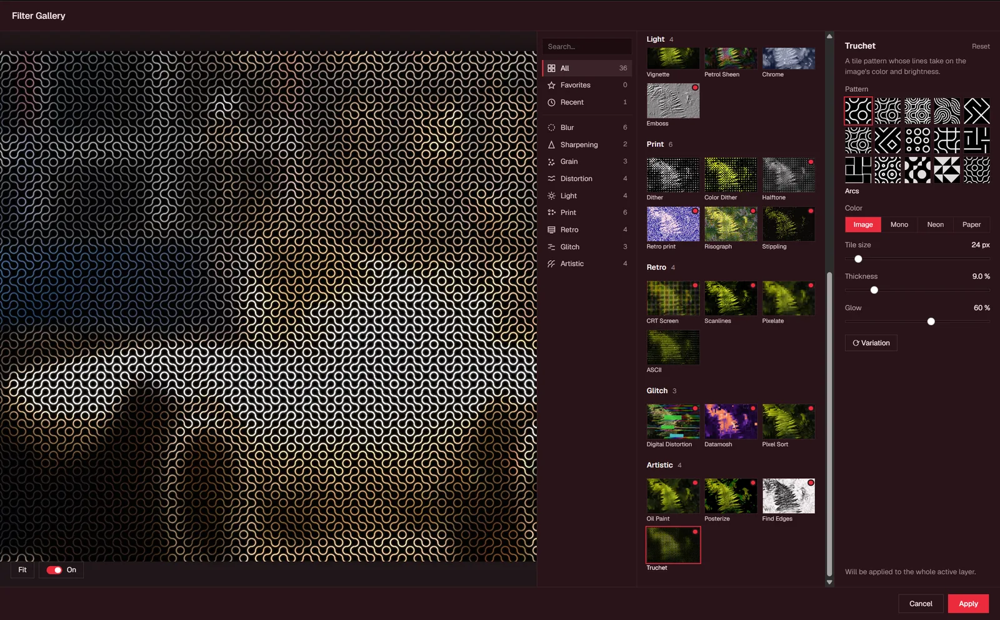</td>
<td width="33%" valign="top">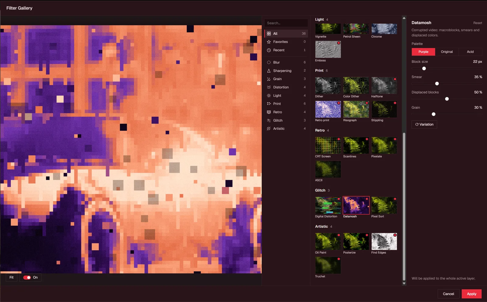</td>
<td width="33%" valign="top">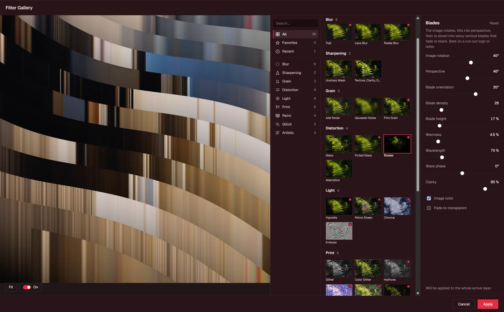</td>
</tr>
</table>

36 filtres avec aperçu en direct, favoris et « Dernier filtre » (Ctrl+F) : flou, netteté, grain, déformation, lumière, impression (tramage, demi-teinte, risographie, pointillisme), rétro (CRT, lignes de balayage, pixellisation, ASCII), glitch (distorsion numérique, datamosh, tri de pixels) et artistique (peinture à l'huile, postérisation, contours, Truchet). Chacun a ses réglages et un bouton « Variation ».

<details>
<summary><b>Toutes les fonctionnalités</b></summary>

- **Interface** : moderne, 17 thèmes, raccourcis inspirés de Photoshop, notice intégrée en français, anglais, espagnol et allemand
- **Fichiers** : projet `.graf` avec historique et temps de travail ; ouvre PNG, JPEG, WebP, TIFF, AVIF, HEIC et 29 formats RAW (DNG, CR2, CR3, NEF, ARW, RAF…) ; import depuis une adresse web, Ctrl V ou glisser-déposer
- **Calques** : groupes imbriqués, masques de fusion et d'écrêtage, 21 modes de fusion, Si fusion, opacité et fond, verrous, étiquettes, objets dynamiques (incorporés, liés, RAW), filtres dynamiques, 15 calques de réglage, calques de remplissage, recherche de calques
- **Effets de calque** : biseautage, contour, lueurs interne et externe, satin, incrustations, ombre portée, accélérés par la carte graphique
- **Plans de travail** : plusieurs formats dans un document, édition isolée, export par plan
- **Sélection** : rectangle, ellipse, lasso, baguette magique, sélection rapide, sélection avancée (couche, couleur, plage de tons) avec pinceau Affiner et décontamination, masque rapide
- **Peinture** : pinceau et gomme en temps réel sur carte graphique, import ABR/GBR, pack Krita, dynamiques, pinceau double et texture, mélangeur, aérographe, correcteur localisé, pot de peinture, dégradé
- **Texte** : texte de point et de paragraphe, texte dynamique, styles de caractère et kit de marque, 45 familles de polices, petites capitales, écriture bidirectionnelle
- **Vecteur** : plume, sélection directe, formes rectangle, ellipse et polygone avec fond et contour
- **Réglages et filtres** : développement RAW, Camera Raw sur tout calque, 36 filtres avec galerie en direct, Fluidité
- **Transformation** : transformation manuelle avec aperçu carte graphique, perspective et inclinaison, recadrage avec proportions
- **Couleur et impression** : modes RVB, CMJN, Niveaux de gris et Bitmap, 5 profils ICC livrés plus ceux du système, épreuve écran, alerte hors gamme, format d'impression, vérification avant impression, PDF/X-4
- **Export** : JPEG, PNG, WebP, AVIF, TIFF, PDF, en CMJN ou RVB, profil ICC incorporé, métadonnées, export par calque, estimation du poids
- **Références** : bibliothèque My ref avec collections, tags, favoris, et une visionneuse d'images séparée (diaporama, comparaison, EXIF)
- **Performances** : tuiles, composition WebGL2, mémoire RAM et vidéo réglables, disque de travail compressé, récupération après plantage, sauvegarde automatique

</details>

## Pourquoi Lumitype

Lumitype ne se différencie pas spécialement des autres projets existants, mais un soin particulier est apporté pour que le logiciel reste utilisable, sans trop de bugs ni de problèmes !

## État du projet et limites connues

Le projet est développé uniquement le week-end, à cause de mon emploi du temps. Je le rends open source : vous êtes libres de l'améliorer ou de faire un fork de Lumitype sans problème. Servez-vous ! De toute façon, même si j'ai initié le projet, Claude AI est le véritable développeur de cette application !

**Problème connu (Linux seulement) :** avec deux écrans à des fréquences différentes (un écran principal à 240 Hz et un second à 60 Hz, par exemple), l'application se cale sur la plus basse des deux, 60 Hz, même sur l'écran rapide. Cela vient de la façon dont la webview de Linux (WebKitGTK) se synchronise avec l'affichage, pas de Lumitype ; Windows n'est pas concerné. Contournement : mettre les deux écrans à la même fréquence, ou débrancher le lent le temps de dessiner.

## Feuille de route

- Taille de l'image et de la zone de travail, rotation et symétrie du document, rognage
- 16 bits par couche
- Import/export PSD
- Import SVG, PDF et AI
- Tables de correspondance (.cube) et réglages manquants : Tons foncés/Tons clairs, Filtre photo, Remplacement de couleur

Le détail de chaque version est dans [CHANGELOG.md](CHANGELOG.md).

## Crédits et licence

**Auteur :** Claude AI (Fable 5.1, Opus 5.5 et Sonnet 5.5)
**Direction de Claude :** Antoine Deg.

**Licence :** [MIT](LICENSE). Libre d'utilisation, de modification et de redistribution. Les polices incluses conservent leur propre licence (SIL OFL, voir les fichiers `OFL.txt` dans `src-tauri/fonts/`).

---

## Pour les développeurs

<details>
<summary><b>Compiler depuis les sources</b></summary>

| | Linux (Debian/Ubuntu) | Windows 10/11 |
|---|---|---|
| Rust ≥ 1.88 | `curl https://sh.rustup.rs -sSf \| sh` | <https://rustup.rs> (toolchain MSVC) |
| Node ≥ 20 | paquet `nodejs` ou nvm | <https://nodejs.org> |
| Système | voir ci-dessous | « Desktop development with C++ » (VS 2022 Build Tools) ; WebView2 est préinstallé |
| nasm (encodeur AVIF) | Debian/Ubuntu `sudo apt install nasm` · Fedora `sudo dnf install nasm` | `winget install NASM.NASM`, puis ajouter `C:\Program Files\NASM` au PATH (`packaging\windows.bat` fait les deux) |

```sh
# Linux uniquement
sudo apt install libwebkit2gtk-4.1-dev libgtk-3-dev librsvg2-dev libssl-dev pkg-config build-essential nasm
```

nasm n'est nécessaire qu'à la compilation, sur PC x86-64 : c'est l'assembleur de rav1e, l'encodeur de l'export AVIF. Sans lui, la compilation s'arrête sur « NASM build failed » ; les scripts de `packaging/` le vérifient et l'installent avant. Moteur seul, sans nasm : `cargo test -p engine --no-default-features` (AVIF plus lent).

Commandes (identiques sous Linux et Windows) :

```sh
npm install            # dépendances de l'interface + CLI Tauri
npm run tauri dev      # lancement de développement (rechargement à chaud)
npm run tauri build    # binaire et installateurs dans target/release/bundle/
cargo test -p engine   # tests unitaires du moteur
cargo bench -p engine  # benchmarks sur une image 8000 x 8000
npm run check          # vérifications TypeScript + Svelte
npm test               # toutes les vérifications de l'interface
```

Pilote NVIDIA propriétaire sous Linux, fenêtre blanche ou qui scintille : `WEBKIT_DISABLE_DMABUF_RENDERER=1 npm run tauri dev`.

La construction des paquets Linux et Windows (deb, rpm, AppImage, Flatpak, installateur) est décrite dans [`packaging/README.md`](packaging/README.md) : un script par système (`packaging/linux.sh`, `packaging\windows.bat`) construit tous les paquets ; `--release` / `-Release` les renomme pour la Release GitHub et écrit les empreintes. Les paquets Linux compatibles avec les distributions plus anciennes (glibc 2.35) se construisent avec `packaging/linux.sh --compat`, dans un conteneur Ubuntu 22.04 (Podman ou Docker) ; sous Windows, `packaging\linux.bat` fait de même par WSL Ubuntu-22.04.

</details>

<details>
<summary><b>Organisation du projet</b></summary>

```
crates/engine/   moteur d'image : tuiles, document, rendu, E/S (sans dépendance à Tauri)
src-tauri/       coque desktop : état partagé et commandes exposées à l'interface
ui/              interface Svelte 5 : thème, raccourcis, viewport WebGL2, panneaux
```

</details>

<details>
<summary><b>Le format de projet <code>.graf</code></b></summary>

Un projet `.graf` est une archive zip non compressée contenant **tout** le document : `manifest.json` (nom et version du format), `document.json` (arbre des calques), `layers/<id>/…png` (tuiles RGBA, alpha droit) et `masks/<id>/…png` (tuiles de masque en niveaux de gris). Aucun fichier externe n'est référencé : une image importée est copiée dans le projet à l'import, le fichier s'ouvre donc tel quel sur une autre machine.

Le format actuel est la version 9 (texte de paragraphe, modes colorimétriques). Un document est écrit dans la plus ancienne version capable de le contenir : les anciennes versions de Lumitype ouvrent encore les projets simples. Détails et règles de version dans `crates/engine/src/io.rs`.

Seule réserve : les polices. Un calque de texte mémorise son rendu, il s'affiche donc à l'identique partout ; pour *modifier* son texte avec le même aspect, la police doit être installée sur la machine (sinon une police de repli est utilisée). Les anciens fichiers `.iep` s'ouvrent toujours.

</details>
