<p align="center">
  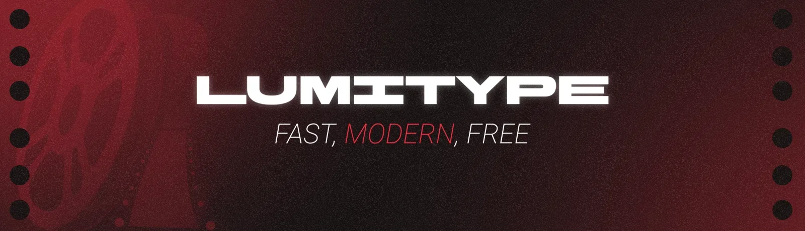
</p>

<p align="center"><b>English</b> · <a href="README.fr.md">Français</a></p>

<p align="center">
  
  
  
  
  
  
</p>

The name Lumitype comes from a historic typesetting machine. I used Claude AI to develop this software, whose main strengths are performance, being free, and a modern interface.

## Download Lumitype 1.2.88

**Choose your system.** Free, no account needed.

| System | Package | Install |
|---|---|---|
| **Windows 10 / 11** | [Lumitype-Windows-Setup.exe](https://github.com/splaching-boop/Lumitype/releases/latest/download/Lumitype-Windows-Setup.exe) | Double-click the installer |
| **Windows**: MSI package | [Lumitype-Windows.msi](https://github.com/splaching-boop/Lumitype/releases/latest/download/Lumitype-Windows.msi) | For IT deployment (Intune, GPO) or silent install: `msiexec /i Lumitype-Windows.msi /qn` |
| **Windows**: portable | [Lumitype-Windows-portable.exe](https://github.com/splaching-boop/Lumitype/releases/latest/download/Lumitype-Windows-portable.exe) | No installation: run it from any folder or a USB stick |
| **Fedora** · RHEL · openSUSE | [Lumitype-Fedora-x86_64.rpm](https://github.com/splaching-boop/Lumitype/releases/latest/download/Lumitype-Fedora-x86_64.rpm) | `sudo dnf install ./Lumitype-Fedora-x86_64.rpm` |
| **Debian** · Ubuntu · Mint | [Lumitype-Debian-Ubuntu-amd64.deb](https://github.com/splaching-boop/Lumitype/releases/latest/download/Lumitype-Debian-Ubuntu-amd64.deb) | `sudo apt install ./Lumitype-Debian-Ubuntu-amd64.deb` |
| **Any Linux**: AppImage | [Lumitype-Linux-x86_64.AppImage](https://github.com/splaching-boop/Lumitype/releases/latest/download/Lumitype-Linux-x86_64.AppImage) | `chmod +x Lumitype-Linux-x86_64.AppImage && ./Lumitype-Linux-x86_64.AppImage` |
| **Any Linux**: Flatpak | [Lumitype-Linux.flatpak](https://github.com/splaching-boop/Lumitype/releases/latest/download/Lumitype-Linux.flatpak) | `flatpak install --user ./Lumitype-Linux.flatpak` |
| **Any Linux**: portable archive | [Lumitype-Linux-portable.tar.gz](https://github.com/splaching-boop/Lumitype/releases/latest/download/Lumitype-Linux-portable.tar.gz) | `tar -xzf Lumitype-Linux-portable.tar.gz` |

Linux packages require glibc 2.35 or newer (Ubuntu 22.04, Mint 21, Debian 12, Fedora 36 and later). On Windows, the software uses WebView2 (included).

[All versions](https://github.com/splaching-boop/Lumitype/releases) · [Verify checksums (SHA256SUMS.txt)](https://github.com/splaching-boop/Lumitype/releases/latest/download/SHA256SUMS.txt)

<p align="center">
  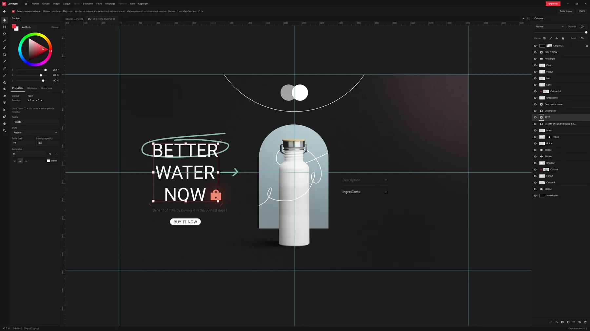
  <br>
  <sub><i>Working interface: Lumitype</i></sub>
</p>

## What's new

**Linux packages for every distribution.** Packages are built against glibc 2.35: they start on Linux Mint 21+, Ubuntu 22.04+, Debian 12+, Fedora 36+ and newer. Flatpak uses the GNOME 51 runtime. Fixes "GLIBC_2.43 not found" on Mint 22.

Also: built-in user manual in 4 languages (F1), redesigned Preferences, 13 new themes, pre-press check before export, PDF/X-4, work time per project, imports and new layers stay inside the active artboard.

## Features

<table>
<tr>
<td width="33%" valign="top">
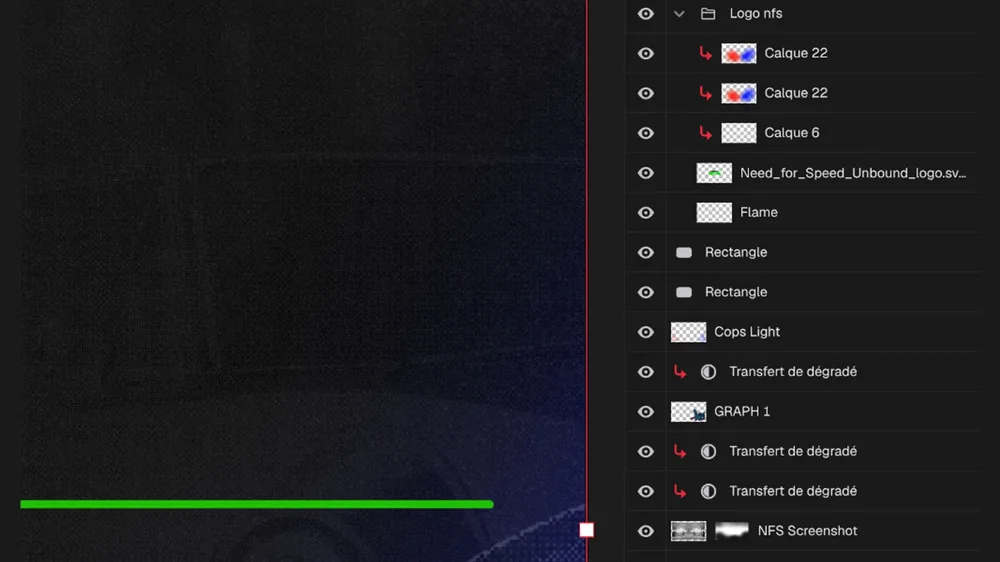
<h3>Layer organisation</h3>
<p>Layer masks, clipping masks and groups. I tried to faithfully reproduce the Photoshop workflow.</p>
</td>
<td width="33%" valign="top">
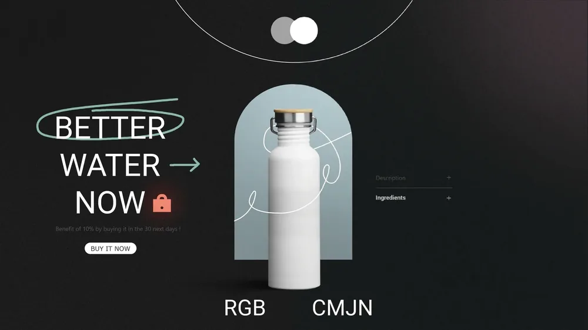
<h3>Made for print</h3>
<p>CMYK preview with ICC profiles (FOGRA, GRACoL, SWOP), ink-coverage warning, bleed and safe area, separations, a pre-press check and PDF/X-4 export.</p>
</td>
<td width="33%" valign="top">
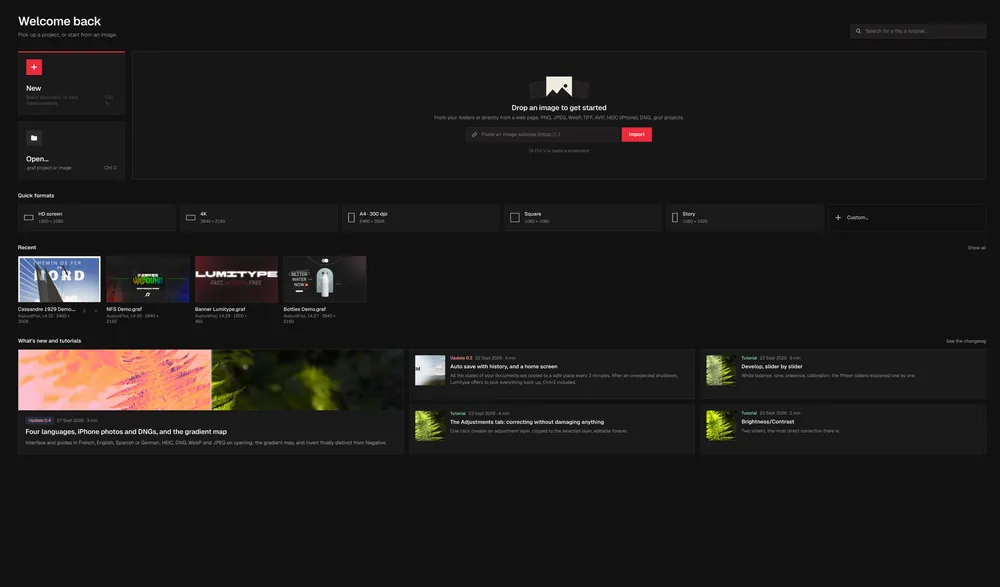
<h3>Simple home screen</h3>
<p>Find your recent projects, or drop any image from your browser to start a project!</p>
</td>
</tr>
</table>

### Magnetic guides

Snap your images, the pen tool or text to guides: much more convenient!


### A complete selection of guides

<p align="center">
  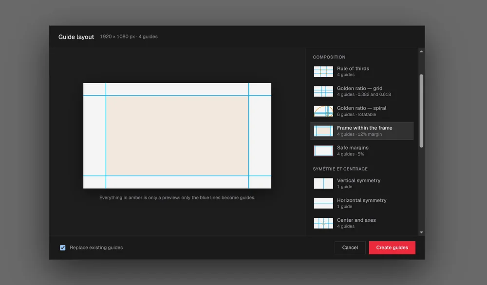
</p>

Use the built-in composition guides to lay out your poster, your banner or any other graphic content!

## Made for designers

<table>
<tr>
<td width="50%" valign="top">
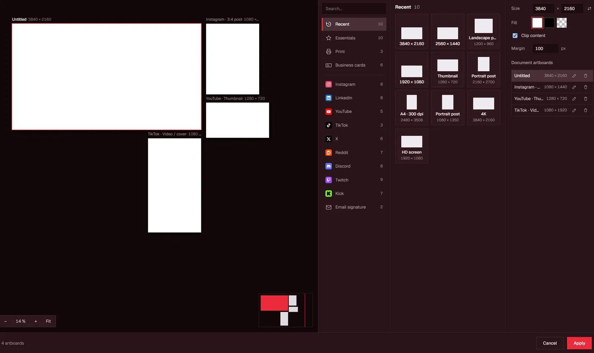
<h3>Several artboards in one document</h3>
<p>Social formats, print formats and business cards side by side, each exported on its own. Pick a format from the built-in catalogue (Instagram, LinkedIn, YouTube, TikTok, A4, business cards) or type a size.</p>
</td>
<td width="50%" valign="top">
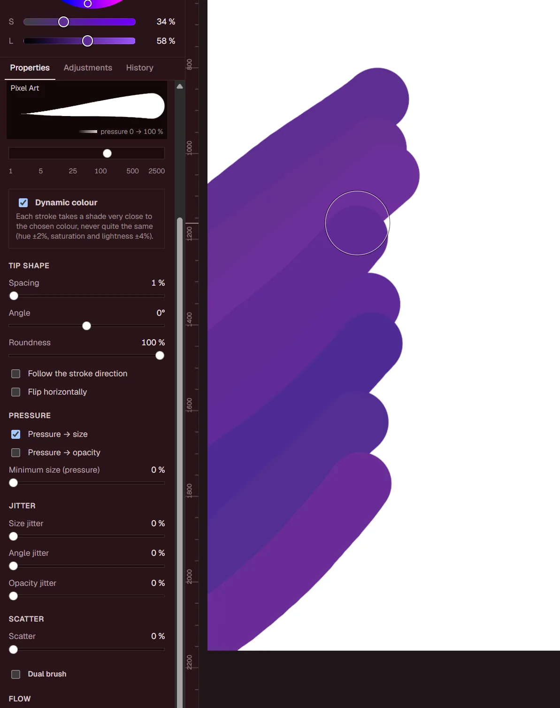
<h3>Better brush support</h3>
<p>Import Photoshop (.abr) and GIMP (.gbr) brushes, or any image as a tip. Spacing, angle, roundness, pressure, jitter, scatter, dual brush, texture and flow, with a live preview of the tip. Strokes are painted on the GPU, in real time.</p>
</td>
</tr>
<tr>
<td width="50%" valign="top">
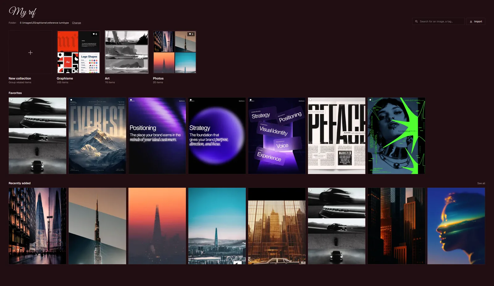
<h3>My ref: your reference library</h3>
<p>Collect inspiration in collections, favourites and tags, straight from a folder on your disk. Search by name or tag, drop an image into the library from the browser.</p>
</td>
<td width="50%" valign="top">
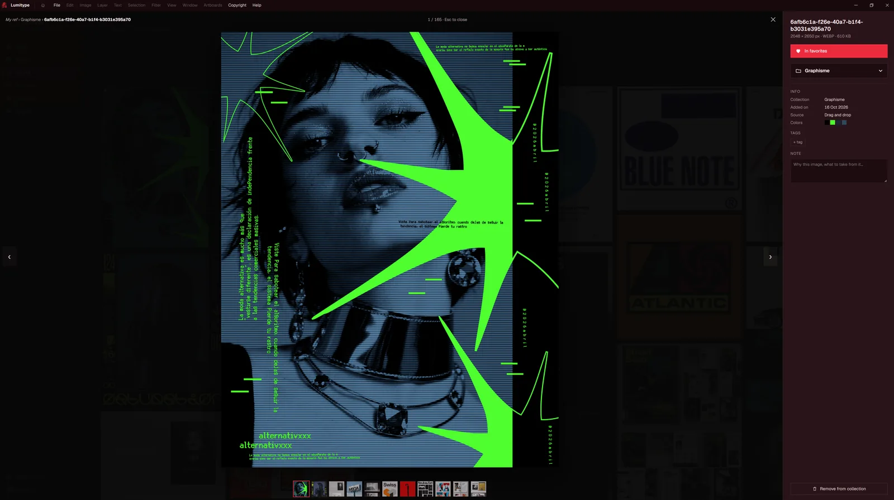
<h3>Notes on every reference</h3>
<p>Each image keeps its collection, colours, tags and a note on what to take from it. One click sends it into the current project.</p>
</td>
</tr>
<tr>
<td width="50%" valign="top">
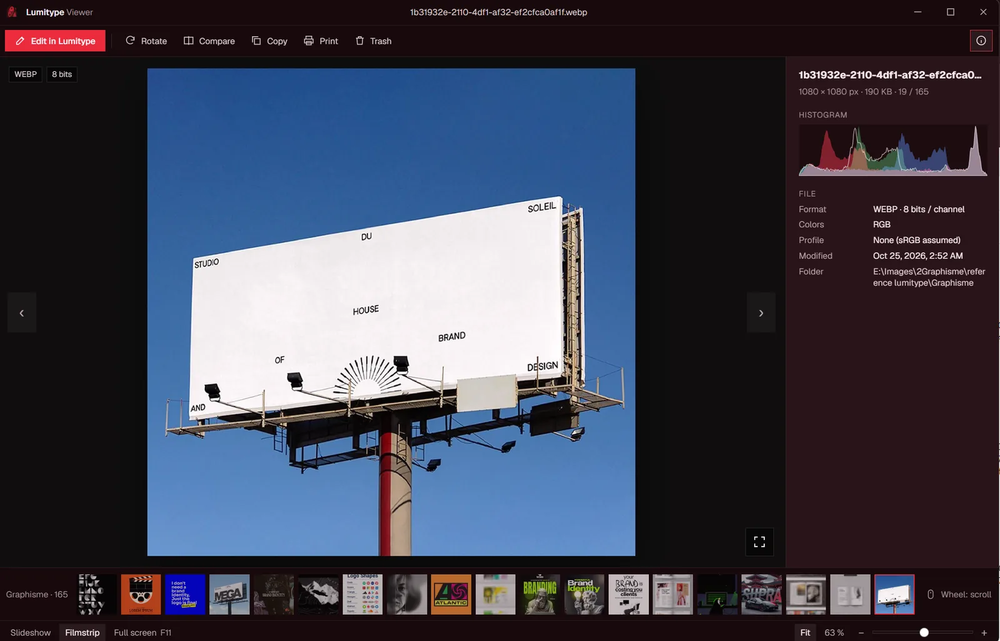
<h3>Lumitype Viewer</h3>
<p>A separate, lightweight image viewer, made first for Linux users who want to browse their RAW files (ARW, CR3, NEF, DNG and 25 more formats) alongside JPEG, PNG, WebP, AVIF and HEIC. Histogram, EXIF, ICC profile, slideshow, side-by-side compare, lossless rotation, then "Edit in Lumitype".</p>
</td>
<td width="50%" valign="top">
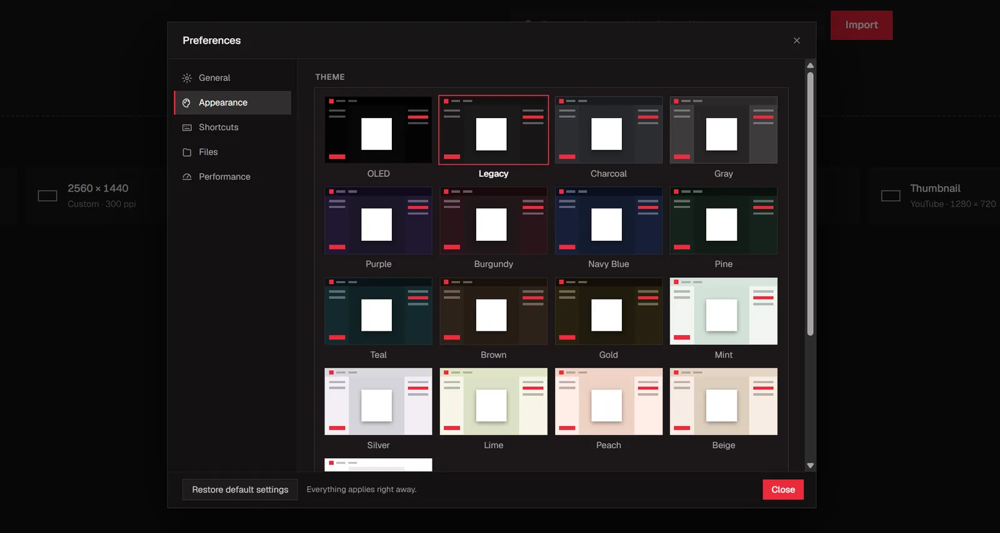
<h3>17 themes</h3>
<p>From OLED black to light Beige, each with its accent colour. Everything in Preferences applies right away.</p>
</td>
</tr>
</table>

### Filter gallery

<table>
<tr>
<td width="33%" valign="top">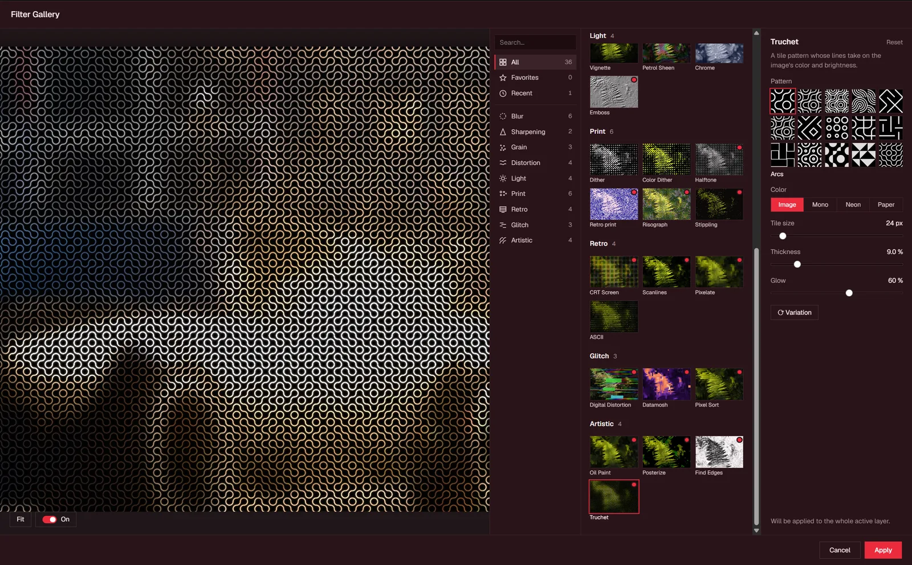</td>
<td width="33%" valign="top">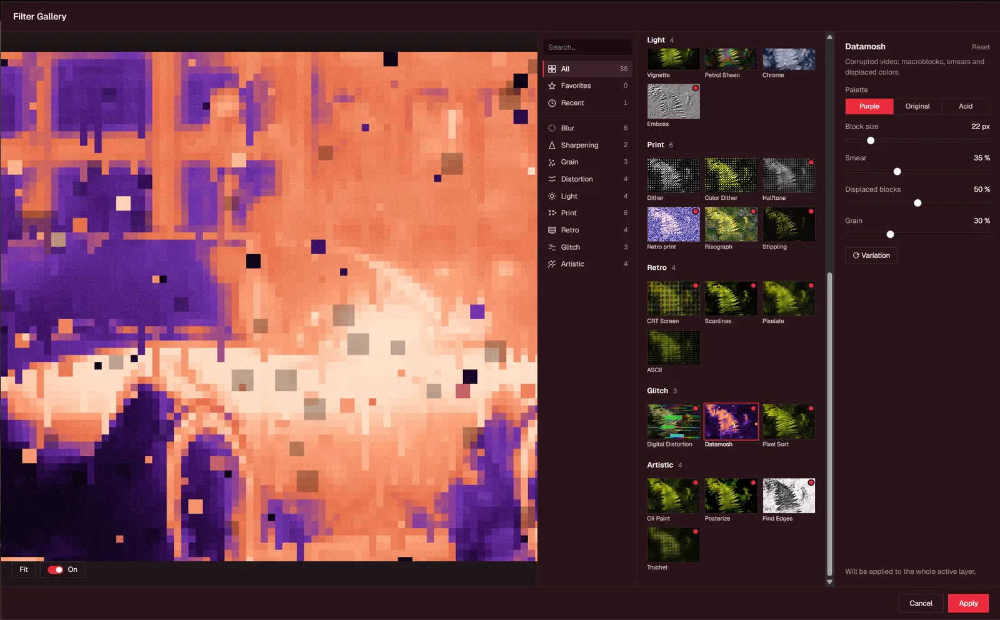</td>
<td width="33%" valign="top">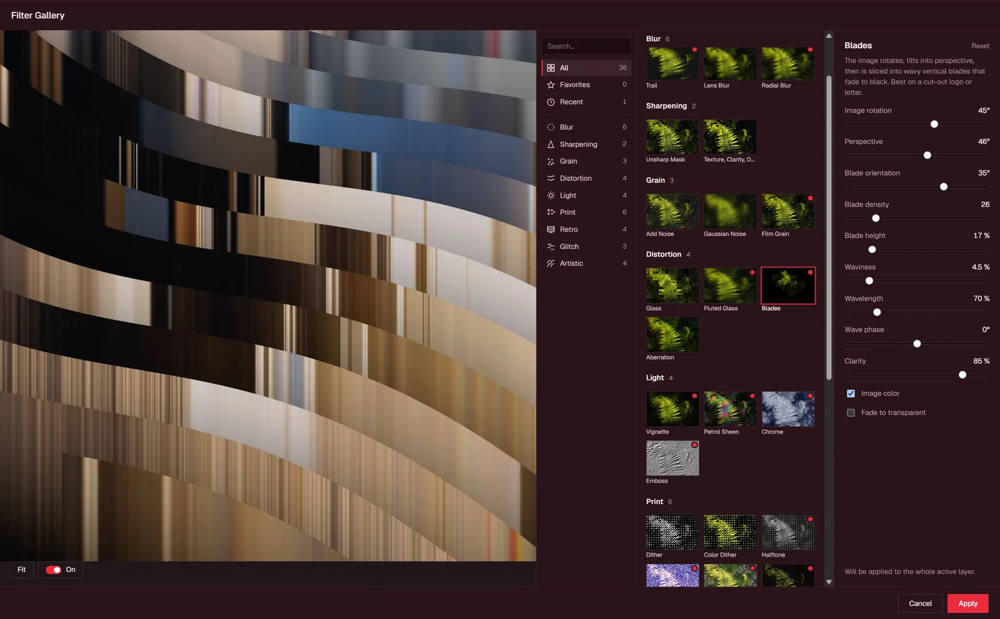</td>
</tr>
</table>

36 filters with a live preview, favourites and "Last filter" (Ctrl+F): blur, sharpening, grain, distortion, light, print (dither, halftone, risograph, stippling), retro (CRT, scanlines, pixelate, ASCII), glitch (digital distortion, datamosh, pixel sort) and artistic (oil paint, posterize, find edges, Truchet). Each one has its own settings and a "Variation" button.

<details>
<summary><b>All features</b></summary>

- **Interface**: modern, 17 themes, keyboard shortcuts based on Photoshop's, built-in manual in French, English, Spanish and German
- **Files**: `.graf` project with history and work time; opens PNG, JPEG, WebP, TIFF, AVIF, HEIC and 29 RAW formats (DNG, CR2, CR3, NEF, ARW, RAF…); import from a web address, Ctrl V or drag and drop
- **Layers**: nested groups, layer masks and clipping masks, 21 blend modes, Blend If, opacity and fill, locks, labels, smart objects (embedded, linked, RAW), smart filters, 15 adjustment layers, fill layers, layer search
- **Layer effects**: bevel, stroke, inner and outer glow, satin, overlays, drop shadow, hardware-accelerated
- **Artboards**: several formats in one document, isolated editing, export per artboard
- **Selection**: rectangle, ellipse, lasso, magic wand, quick selection, advanced selection (channel, colour, tonal range) with refine brush and decontamination, quick mask
- **Painting**: real-time GPU brush and eraser, ABR/GBR import, Krita pack, dynamics, dual brush and texture, mixer, spray, spot healing, paint bucket, gradient
- **Text**: point and paragraph text, dynamic text, character styles and brand kit, 45 bundled font families, small caps, bidirectional layout
- **Vector**: pen, direct selection, rectangle, ellipse and polygon shapes with fill and stroke
- **Adjustments and filters**: RAW develop, Camera Raw on any layer, 36 filters with live gallery, Liquify
- **Transformation**: free transform with GPU preview, perspective and skew, crop with ratios
- **Colour and print**: RGB, CMYK, Greyscale and Bitmap modes, 5 bundled ICC profiles plus system profiles, soft proof, out-of-gamut warning, print setup, pre-press check, PDF/X-4
- **Export**: JPEG, PNG, WebP, AVIF, TIFF, PDF, CMYK or RGB, embedded ICC, metadata, per-layer export, size estimate
- **References**: My ref library with collections, tags, favourites and a separate image viewer (slideshow, compare, EXIF)
- **Performance**: tiles, WebGL2 compositing, adjustable RAM and VRAM budget, compressed scratch disk, crash recovery, autosave

</details>

## Why Lumitype

Lumitype is not especially different from other existing projects, but particular care goes into keeping the software usable, without too many bugs or problems!

## Project status and known limitations

The project is developed on weekends only, because of my schedule. It is open source, so you are free to improve it or fork Lumitype without any problem. Help yourself! Anyway, even though I started the project, Claude AI is the real developer of this application!

**Known issue (Linux only):** with two screens running at different refresh rates (a 240 Hz main screen and a 60 Hz second one, for example), the application runs at the lowest of the two, 60 Hz, even on the fast screen. This comes from the way the Linux webview (WebKitGTK) synchronises with the display, not from Lumitype itself; Windows is not affected. Workaround: set both screens to the same refresh rate, or unplug the slow one while drawing.

## Roadmap

- Image size / canvas size, whole-document rotation and flip, trim
- 16-bit per channel
- PSD import/export
- SVG, PDF and AI import
- Colour lookup tables (.cube) and the missing adjustments: Shadows/Highlights, Photo filter, Replace colour

See [CHANGELOG.md](CHANGELOG.md) for what each version brought.

## Credits and license

**Author:** Claude AI (Fable 5.1, Opus 5.5 and Sonnet 5.5)
**Directed by:** Antoine Deg.

**License:** [MIT](LICENSE). Free to use, modify and redistribute. The bundled fonts keep their own licenses (SIL OFL, see the `OFL.txt` files in `src-tauri/fonts/`).

---

## For developers

<details>
<summary><b>Build from source</b></summary>

| | Linux (Debian/Ubuntu) | Windows 10/11 |
|---|---|---|
| Rust ≥ 1.88 | `curl https://sh.rustup.rs -sSf \| sh` | <https://rustup.rs> (MSVC toolchain) |
| Node ≥ 20 | `nodejs` package or nvm | <https://nodejs.org> |
| System | see below | "Desktop development with C++" (VS 2022 Build Tools); WebView2 is preinstalled |
| nasm (AVIF encoder) | Debian/Ubuntu `sudo apt install nasm` · Fedora `sudo dnf install nasm` | `winget install NASM.NASM`, then add `C:\Program Files\NASM` to PATH (`packaging\windows.bat` does both) |

```sh
# Linux only
sudo apt install libwebkit2gtk-4.1-dev libgtk-3-dev librsvg2-dev libssl-dev pkg-config build-essential nasm
```

nasm is only needed to build, on x86-64 PCs: it is the assembler of rav1e, the encoder behind the AVIF export. Without it the build stops with "NASM build failed"; the `packaging/` scripts check for it and install it first. Engine alone, without nasm: `cargo test -p engine --no-default-features` (slower AVIF).

Commands (identical on Linux and Windows):

```sh
npm install            # interface dependencies + Tauri CLI
npm run tauri dev      # development run (hot reload of the interface)
npm run tauri build    # binary and installers in target/release/bundle/
cargo test -p engine   # engine unit tests
cargo bench -p engine  # benchmarks on an 8000 x 8000 image
npm run check          # TypeScript + Svelte checks
npm test               # all interface checks at once
```

Proprietary NVIDIA driver on Linux, blank or flickering window: `WEBKIT_DISABLE_DMABUF_RENDERER=1 npm run tauri dev`.

Building the Linux and Windows packages (deb, rpm, AppImage, Flatpak, installer) is described in [`packaging/README.md`](packaging/README.md) (in French): one script per system (`packaging/linux.sh`, `packaging\windows.bat`) builds every package; `--release` / `-Release` renames them for a GitHub release and writes the checksums. Linux packages that run on older distributions (glibc 2.35) are built with `packaging/linux.sh --compat`, in an Ubuntu 22.04 container (Podman or Docker); on Windows, `packaging\linux.bat` does the same through WSL Ubuntu-22.04.

</details>

<details>
<summary><b>Project layout</b></summary>

```
crates/engine/   image engine: tiles, document, rendering, I/O (no Tauri dependency)
src-tauri/       desktop shell: shared state and commands exposed to the interface
ui/              Svelte 5 interface: theme, keymap, WebGL2 viewport, panels
```

</details>

<details>
<summary><b>The <code>.graf</code> project format</b></summary>

A `.graf` project is an uncompressed zip archive containing the **whole** document: `manifest.json` (format name and version), `document.json` (layer tree), `layers/<id>/…png` (RGBA tiles, straight alpha) and `masks/<id>/…png` (greyscale mask tiles). It references no external file: an imported image is copied into the project at import time, so the file opens as is on another machine.

The current format is version 9 (paragraph text, colour modes). A document is written in the oldest version able to hold it, so earlier versions of Lumitype still open simple projects. Details and versioning rules are in `crates/engine/src/io.rs`.

Only caveat: fonts. A text layer stores its rendering, so it looks identical everywhere; to *edit* its text with the same appearance, the font must be installed on the machine (otherwise a fallback font is used). Old `.iep` files still open.

</details>
