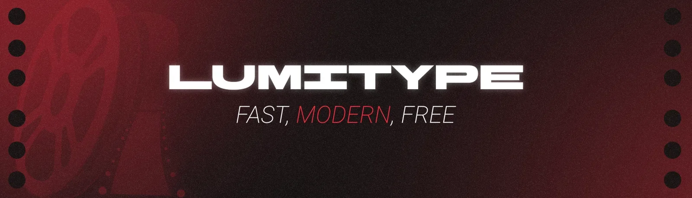
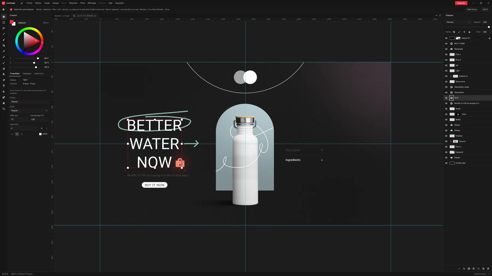
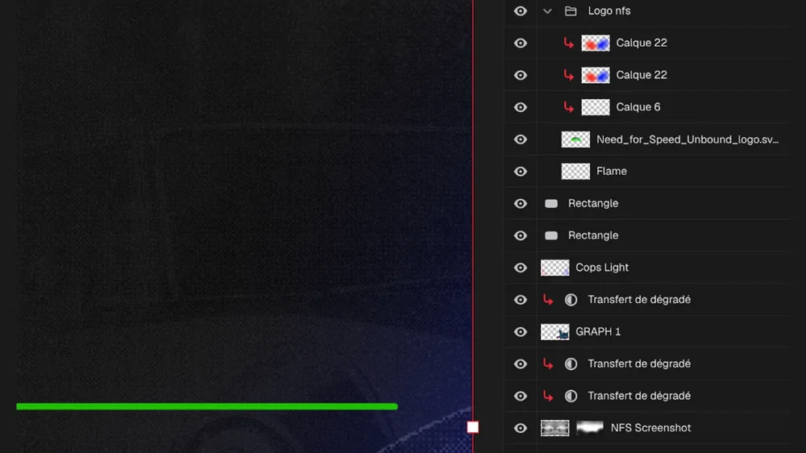
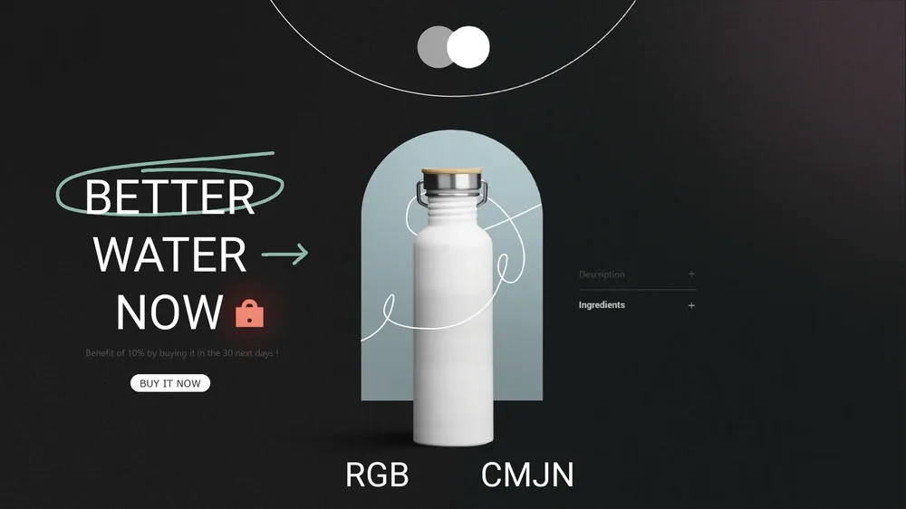
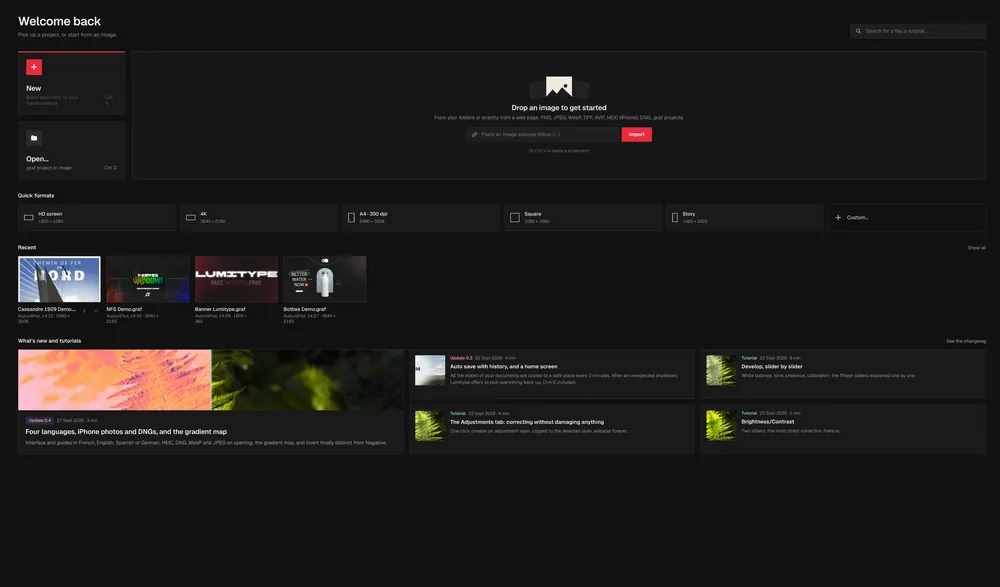
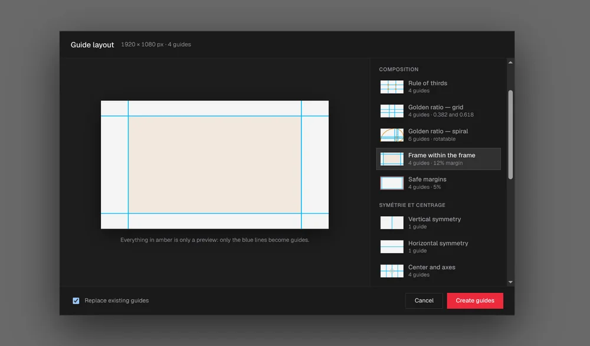

<p align="center">
  
</p>

<p align="center"><b>English</b> · <a href="README.fr.md">Français</a></p>

<p align="center">
  
  
  
  
  
  
</p>

The name Lumitype comes from a historic typesetting machine. I used Claude AI to develop this software, whose main strengths are performance, being free, and a modern interface.

## ⬇ Download Lumitype 1.1.0

**Choose your system.** Free, no account needed.

| System | Package | Install |
|---|---|---|
| **Windows 10 / 11** | [Lumitype-Windows-Setup.exe](https://github.com/splaching-boop/Lumitype/releases/latest/download/Lumitype-Windows-Setup.exe) | Double-click the installer |
| **Fedora** · RHEL · openSUSE | [Lumitype-Fedora-x86_64.rpm](https://github.com/splaching-boop/Lumitype/releases/latest/download/Lumitype-Fedora-x86_64.rpm) | `sudo dnf install ./Lumitype-Fedora-x86_64.rpm` |
| **Debian** · Ubuntu · Mint | [Lumitype-Debian-Ubuntu-amd64.deb](https://github.com/splaching-boop/Lumitype/releases/latest/download/Lumitype-Debian-Ubuntu-amd64.deb) | `sudo apt install ./Lumitype-Debian-Ubuntu-amd64.deb` |
| **Any Linux**: AppImage | [Lumitype-Linux-x86_64.AppImage](https://github.com/splaching-boop/Lumitype/releases/latest/download/Lumitype-Linux-x86_64.AppImage) | `chmod +x Lumitype-Linux-x86_64.AppImage && ./Lumitype-Linux-x86_64.AppImage` |
| **Any Linux**: Flatpak | [Lumitype-Linux.flatpak](https://github.com/splaching-boop/Lumitype/releases/latest/download/Lumitype-Linux.flatpak) | `flatpak install --user ./Lumitype-Linux.flatpak` |
| **Any Linux**: portable archive | [Lumitype-Linux-portable.tar.gz](https://github.com/splaching-boop/Lumitype/releases/latest/download/Lumitype-Linux-portable.tar.gz) | `tar -xzf Lumitype-Linux-portable.tar.gz` |

On Windows, the software uses WebView2 (included).

[All versions](https://github.com/splaching-boop/Lumitype/releases) · [Verify checksums (SHA256SUMS.txt)](https://github.com/splaching-boop/Lumitype/releases/latest/download/SHA256SUMS.txt)

<p align="center">
  
  <br>
  <sub><i>Working interface: Lumitype</i></sub>
</p>

## Features

<table>
<tr>
<td width="33%" valign="top">

<h3>Layer organisation</h3>
<p>Layer masks, clipping masks and groups. I tried to faithfully reproduce the Photoshop workflow.</p>
</td>
<td width="33%" valign="top">

<h3>CMYK preview</h3>
<p>For those working on printed posters, a CMYK preview is available in the software!</p>
</td>
<td width="33%" valign="top">

<h3>Simple home screen</h3>
<p>Find your recent projects, or drop any image from your browser to start a project!</p>
</td>
</tr>
</table>

### Magnetic guides

Snap your images, the pen tool or text to guides: much more convenient!

<!-- TODO: add an image, for example docs/images/magnetic-guides.webp -->

### A complete selection of guides

<p align="center">
  
</p>

Use the built-in composition guides to lay out your poster, your banner or any other graphic content!

<details>
<summary><b>All features</b></summary>

- **Interface**: modern, keyboard shortcuts based on Photoshop's
- **Files**: `.graf` project (v7); opens PNG, JPEG, WebP, TIFF, AVIF, HEIC, DNG; import from a web address or Ctrl V
- **Layers**: nested groups, layer masks and clipping masks, 21 blend modes, opacity and fill, locks, smart objects
- **Layer effects**: shadows, strokes, gradients, hardware-accelerated (GPU)
- **Selection**: rectangle, ellipse, lasso, magic wand, add, subtract, intersect
- **Painting**: brush, eraser, paint bucket, eyedropper, pen, gradient, gradient transfer
- **Text**: on-canvas editor, 45 bundled font families, font weights with live preview, font fallback
- **Adjustments and filters**: develop, brightness, levels, Filter menu with thumbnails inspired by Lightroom
- **Transformation**: frame, rotation, crop
- **Colour**: colour wheel, CMYK preview with 5 ICC profiles
- **Export**: JPEG, PNG, WebP with size estimate
- **Performance**: tiles, adjustable dynamic memory (RAM and VRAM), compressed scratch disk, GPU rendering
- **History** and crash recovery
- **Composition**: many ready-made guides to help you lay out your work

</details>

## Why Lumitype

Lumitype is not especially different from other existing projects, but particular care goes into keeping the software usable, without too many bugs or problems!

## Project status and known limitations

The project is developed on weekends only, because of my schedule. It is open source, so you are free to improve it or fork Lumitype without any problem. Help yourself! Anyway, even though I started the project, Claude AI is the real developer of this application!

## Roadmap

Known issues and future improvements:

- The transformation tool is sometimes imprecise, depending on the circumstances
- Imprecise transformation with layer masks
- More filters in the future
- Better brush support (brushes were not tested in the current version)
- RAW image support

## Credits and license

**Author:** Claude AI (Fable 5.1, Opus 5.5 and Sonnet 5.5)
**Directed by:** Antoine Deg.

**License:** [MIT](LICENSE). Free to use, modify and redistribute. The bundled fonts keep their own licenses (SIL OFL, see the `OFL.txt` files in `src-tauri/fonts/`).

---

## For developers

<details>
<summary><b>Build from source</b></summary>

| | Linux (Debian/Ubuntu) | Windows 10/11 |
|---|---|---|
| Rust ≥ 1.88 | `curl https://sh.rustup.rs -sSf \| sh` | <https://rustup.rs> (MSVC toolchain) |
| Node ≥ 20 | `nodejs` package or nvm | <https://nodejs.org> |
| System | see below | "Desktop development with C++" (VS 2022 Build Tools); WebView2 is preinstalled |

```sh
# Linux only
sudo apt install libwebkit2gtk-4.1-dev libgtk-3-dev librsvg2-dev libssl-dev pkg-config build-essential
```

Commands (identical on Linux and Windows):

```sh
npm install            # interface dependencies + Tauri CLI
npm run tauri dev      # development run (hot reload of the interface)
npm run tauri build    # binary and installers in target/release/bundle/
cargo test -p engine   # engine unit tests
cargo bench -p engine  # benchmarks on an 8000 x 8000 image
npm run check          # TypeScript + Svelte checks
npm test               # all interface checks at once
```

Proprietary NVIDIA driver on Linux, blank or flickering window: `WEBKIT_DISABLE_DMABUF_RENDERER=1 npm run tauri dev`.

Building the Linux and Windows packages (deb, rpm, AppImage, Flatpak, installer) is described in [`export/LISEZ-MOI.md`](export/LISEZ-MOI.md) (in French). To rename the packages for a release and generate the checksums: `export/renommer-release.sh`.

</details>

<details>
<summary><b>Project layout</b></summary>

```
crates/engine/   image engine: tiles, document, rendering, I/O (no Tauri dependency)
src-tauri/       desktop shell: shared state and commands exposed to the interface
ui/              Svelte 5 interface: theme, keymap, WebGL2 viewport, panels
```

</details>

<details>
<summary><b>The <code>.graf</code> project format (version 7)</b></summary>

A `.graf` project is an uncompressed zip archive containing the **whole** document: `manifest.json` (format name and version), `document.json` (layer tree), `layers/<id>/…png` (RGBA tiles, straight alpha) and `masks/<id>/…png` (greyscale mask tiles). It references no external file: an imported image is copied into the project at import time, so the file opens as is on another machine.

A document without smart objects is written as version 6 (earlier versions of Lumitype still open it); a document containing smart objects is written as version 7. Details and versioning rules are in `crates/engine/src/io.rs`.

Only caveat: fonts. A text layer stores its rendering, so it looks identical everywhere; to *edit* its text with the same appearance, the font must be installed on the machine (otherwise a fallback font is used). Old `.iep` files still open.

</details>
